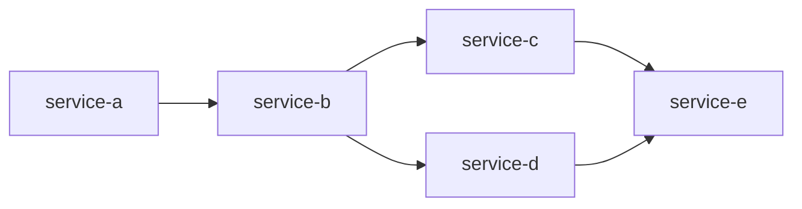

<!-- templates/solution-proposal.md — FUNCTIONAL document. Audience: BA, Ops, PM, engineers.
     Rules: business language; no class names, no SQL; every claim cites a source file.
     Keep every heading. Write "None" where a section is empty. Target length: 2–4 pages. -->

<!-- paste templates/_header.md here with document: solution-proposal -->

# Solution Proposal — <JIRA-KEY>: <Jira summary>

## 1. What is being asked
<!-- 3–6 lines in the BA's own words. Then the four routing fields. -->

| Market | Clearing | Product | Direction | Bucket |
|---|---|---|---|---|
| | | | | <ONBOARDING \| MINOR_INITIATIVE \| ENHANCEMENT \| BUG_FIX> |

**Acceptance criteria (as given)**
1. …

## 2. How it works today
<!-- Describe the current behaviour for the closest existing market/product. Name the pattern.
     Cite: design doc path(s), trace file. -->

**Closest existing pattern:** <market × clearing × product> — chosen because … (`steps/02-route/radius.json`)

**Current flow**


<!-- Source: steps/03-load/normalized/trace-1.json -->

**Static data that drives this flow today** (shape, with example rows from the baseline market, masked)

| Table / Region | Key | Baseline market has | Controls |
|---|---|---|---|
| | | n rows | |
<!-- Source: steps/03-load/normalized/describe-*.json -->

## 3. What will change
<!-- Functional view only. One row per functional change. "New" vs "Reused" is the key message. -->

| # | Functional change | Where in the lifecycle | Reused from baseline or New | Markets affected |
|---|---|---|---|---|
| 1 | | <lifecycle stage> | Reused / New | |

**Target flow** (only if it differs from the current flow)

```mermaid
flowchart LR
  %% highlight changed/new nodes with a comment
```

**Static data to be added or changed** (shape and counts, not SQL)

| Table / Region | Action | Rows (approx.) | Derived from |
|---|---|---|---|
| | ADD / CHANGE | | baseline market <X> with substitution: … |

## 4. What stays the same (invariants)
<!-- From manifests[].invariants for the radius. These are promises to Ops and Risk. -->
- …

## 5. Impact summary for non-technical readers
<!-- Max 6 bullets: who notices what, when; any operational step (new static data load, calendar, cut-off). -->
- …

## 6. Open questions
<!-- Only questions that do NOT block the proposal. Blocking questions go to questions.md and stop the run. -->
| # | Question | For | Why it matters |
|---|---|---|---|

## 7. Confidence at a glance
<!-- Copy from confidence-report.md: overall + four lanes + decision. -->
Overall **<n>/100** — MAP <n> · CODE <n> · DATA <n> · MODEL <n> → **<PROCEED | QUESTIONS>**

## 8. Sources
<!-- Every file cited above, one per line, relative to the run folder or the repo. -->
- `steps/00-input/jira.md`
- `steps/02-route/radius.json`
- `__DESIGN_DOCS_ROOT__/<service>.md`
- `steps/03-load/normalized/…`
